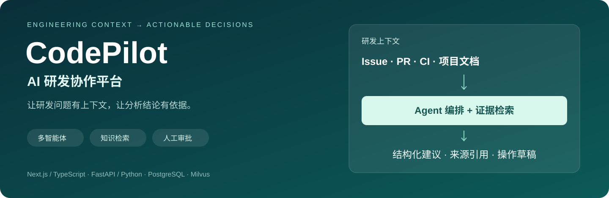
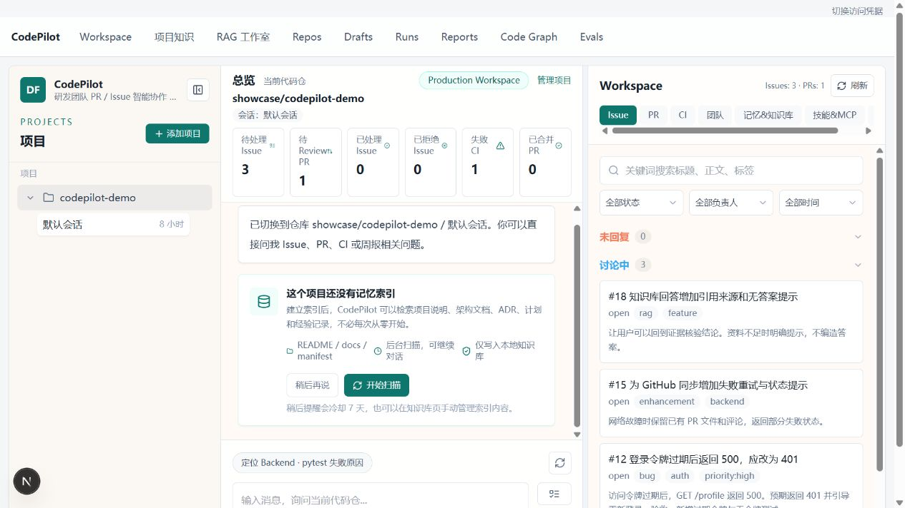
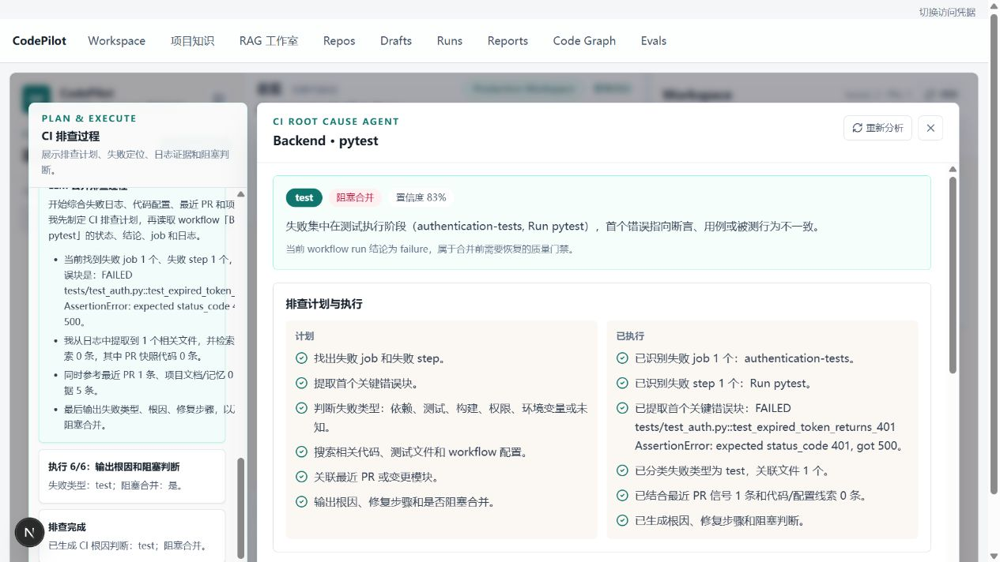
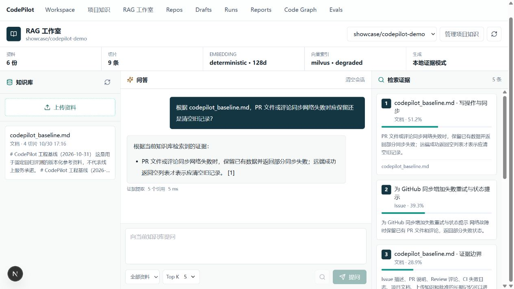
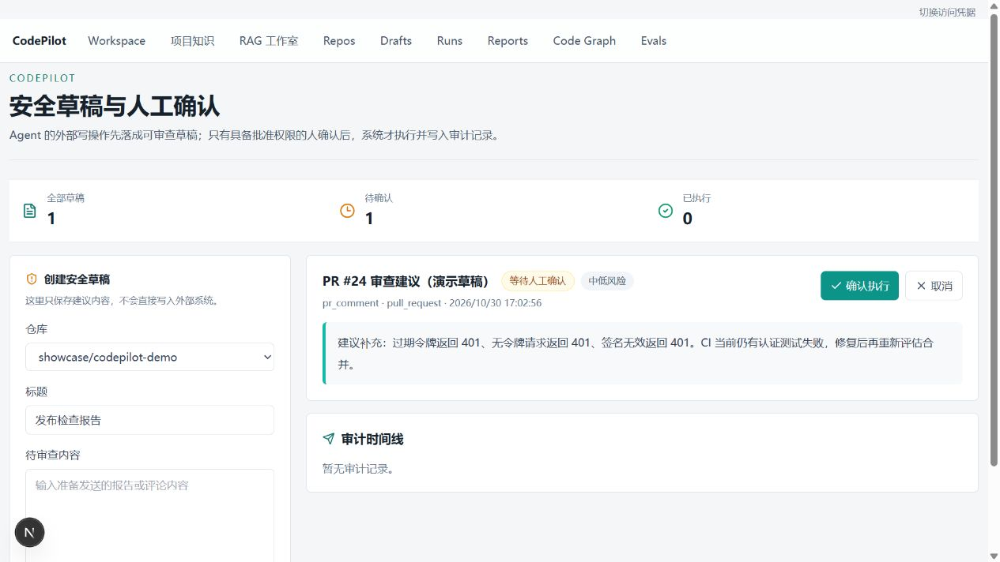
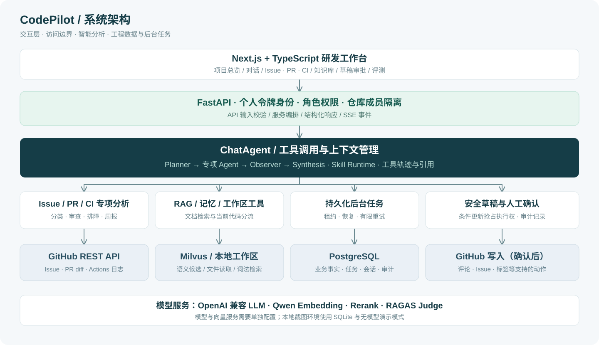

<div align="center">

# CodePilot — AI 研发协作平台

**连接 Issue、PR、CI 与项目知识，让研发分析有上下文、有依据、有执行边界。**

[项目介绍](docs/project_overview.md) · [5 分钟演示](docs/demo_guide.md) · [系统架构](docs/architecture/system_design.md) · [启动指南](docs/getting_started.md) · [RAG 与评测](docs/rag_and_evaluation.md)



</div>

## 30 秒了解项目

CodePilot 是一个面向软件研发团队的全栈 AI Agent 工程项目。它将 GitHub 的需求、代码变更、CI 日志和项目文档连接起来，辅助完成 **Issue 分诊、PR 审查、CI 排障、知识问答与工程周报**。

用户可以直接提问，也可以查看专项分析面板。系统检索当前仓库的证据，调用对应工具或专项 Agent，输出结构化建议、来源引用和可审查的操作草稿；支持的 GitHub 写操作须经有权限的用户确认后执行。

| 你关心的问题 | 项目如何处理 |
| --- | --- |
| 新 Issue 应该优先处理吗？ | 分析类别、优先级、复杂度、负责人候选与下一步行动 |
| 这个 PR 有什么风险？ | 结合 diff 与 Review 评论输出风险、审查清单和测试建议 |
| CI 为什么失败？ | 从失败 job、关键日志和变更上下文生成排障步骤 |
| 可以实际验证 CI 失败吗？ | 可选启用离线 Docker 沙盒，在失败提交运行 pytest，保留日志、退出码与复现历史 |
| 项目里的规则写在哪里？ | 检索项目文档与上传知识，回答中展示证据与引用 |
| 建议能直接改 GitHub 吗？ | 先形成草稿，再由具备审批权限的人确认，记录执行审计 |

**当前验证快照（2026-10-31）：安全依赖更新后，252 项后端测试通过、4 项 Docker 集成测试因服务关闭跳过；TypeScript 检查通过，前端 Lint 零警告，Next.js 生产构建成功。**旧版环境曾完成真实容器验证；新版沙盒镜像尚未在本机重建验证。工程验证结果不等同于安全审计通过，已知剩余风险见 [安全说明](docs/architecture/security.md)。

## 项目界面

以下为**真实应用截图**，使用独立 SQLite 数据库与合成仓库 `showcase/codepilot-demo`。截图环境关闭真实 LLM 与 Milvus，展示业务界面、关键词证据检索和启发式分析；不表示真实仓库分析成绩或完整向量检索效果。

### 研发工作台：把项目、问题和对话放在同一个上下文里



### CI 排障：从“运行失败”进入可检查的分析过程



界面展示排查计划、关键错误、失败类型和合并阻塞判断。此截图来自无模型启发式分析，置信度字段不代表真实模型评测准确率。

<details>
<summary><strong>展开查看：知识问答与人工审批</strong></summary>

### 知识问答与引用



演示环境明确显示向量检索降级；当前画面验证关键词检索和引用展示。

### 安全草稿与人工确认



截图中的草稿尚未执行，未向真实 GitHub 仓库发送评论。

</details>

## 技术亮点与实现依据

| 技术设计 | 解决的问题 | 代码入口 |
| --- | --- | --- |
| 原生工具调用 + 多 Agent 工作流 | 单个问题可能同时涉及 PR、CI、项目知识，需要规划、核验与综合 | [ChatAgent](backend/app/services/agents/chat_agent.py)、[工作流编排](backend/app/services/agents/workflow_orchestrator.py) |
| RAG 与当前代码、实时状态分流 | 避免用旧文档代替当前源码，或把向量候选当作实时事实 | [来源策略](backend/app/services/rag/source_policy.py)、[工作区工具](backend/app/services/workspace_tools.py) |
| 上下文压缩、会话记忆与 Skill Runtime | 支持多轮分析，控制上下文输入，并约束任务可用工具 | [上下文管理](backend/app/services/context_compression.py)、[Skill 注册](backend/app/services/skills/registry.py) |
| 个人令牌 + 角色权限 + 仓库范围过滤 | 区分用户，阻止普通成员读取其他仓库的数据 | [身份与隔离](backend/app/services/authentication.py) |
| 草稿状态原子抢占 + 人工确认 | 防止并发点击重复执行；外部结果不明时停止自动重试 | [草稿执行](backend/app/api/routes/action_drafts.py) |
| 持久化任务、有限重试与显式迁移 | 改善重启恢复、同步失败保留数据和数据库升级的可靠性 | [任务队列](backend/app/services/jobs.py)、[迁移](backend/alembic/versions/0001_reliability.py) |
| CI 失败复现沙盒 | 隔离执行失败提交的 pytest，为 CI 分析补充实际验证证据；限制网络、权限和资源 | [执行器](backend/app/services/ci_sandbox.py)、[启用与边界](docs/ci_sandbox.md) |
| 固定评测集 + RAGAS + 回归检查 | 区分“程序跑通”和“回答质量达标”，保留逐题证据与评分 | [固定案例](docs/datas/evals/rag_cases.json)、[评测实现](backend/app/services/evals/ragas_runner.py) |

专项工作流采用 **Planner → 专项 Agent → Observer → Synthesis**：规划任务及依赖，执行就绪任务，检查冲突与证据缺失，最后综合输出决策备忘录。详细过程见 [Agent 工作流](docs/architecture/agent_workflow.md)。

## 系统架构



| 层次 | 主要技术 |
| --- | --- |
| 前端交互 | Next.js 15、React 19、TypeScript、Tailwind CSS、SSE 流式事件 |
| 后端服务 | Python、FastAPI、Pydantic、SQLAlchemy、Alembic |
| Agent 与模型 | LangChain / LangGraph、原生工具调用、OpenAI 兼容模型接口 |
| 知识检索 | Milvus、Embedding、关键词/向量混合检索、重排、证据与引用 |
| 数据与任务 | PostgreSQL、数据库持久化任务、SQLite 本地演示 |
| 质量验证 | pytest、RAGAS、TypeScript、ESLint、GitHub Actions |

## 本地运行

首次安装与完整服务配置见 **[启动指南](docs/getting_started.md)**。它区分两种运行方式：

- **界面演示**：SQLite、合成数据、无模型回退，可体验页面与基础分析流程。
- **完整检索与模型分析**：配置 PostgreSQL、Milvus、Embedding、LLM；用实际证据验证模型回答。

已有 Python 虚拟环境和前端依赖后，可在 Windows 项目根目录启动独立的文档演示环境：

```powershell
.\scripts\start_docs_preview.ps1
```

访问 `http://127.0.0.1:3019`。演示数据位于 `.data/docs-preview`，与现有业务库分开。截图复现与演示顺序见 [5 分钟演示指南](docs/demo_guide.md)。

**可选：启用 CI 失败复现。**构建 `sandbox/python` 镜像、执行 `python -m alembic upgrade head`，并设置 `CI_SANDBOX_ENABLED=true`。随后在 CI 分析面板运行失败提交的 pytest，查看日志和退出码，再重新分析以引用验证结果。默认镜像需按项目预装依赖；命令失败不等于已复现原 CI 根因。完整步骤与限制见 [CI 复现沙盒](docs/ci_sandbox.md)。

**本地 PostgreSQL 连接检查：**Windows 已有 `.data/pgdata` 时，运行 `.\scripts\start_postgres.ps1` 可按需启动原数据库、执行迁移并检查连接；在 `backend` 运行 `python -m app.db.doctor` 可单独诊断。`/health/ready` 实查数据库和迁移状态，未就绪返回 503。完整配置见 [启动指南](docs/getting_started.md)。

## 文档导航

| 文档 | 适合了解什么 |
| --- | --- |
| [项目介绍](docs/project_overview.md) | 项目背景、使用场景和可展示的工程能力 |
| [5 分钟演示](docs/demo_guide.md) | 按场景演示项目，理解截图和真实运行边界 |
| [启动指南](docs/getting_started.md) | 安装、演示模式、完整服务、常见问题 |
| [系统设计](docs/architecture/system_design.md) | 服务关系、证据边界和关键取舍 |
| [Agent 工作流](docs/architecture/agent_workflow.md) | 工具调用、任务依赖、观察与综合 |
| [RAG 与评测](docs/rag_and_evaluation.md) | 文档处理、检索、固定基线与质量门槛 |
| [数据模型](docs/architecture/database_schema.md) | 核心实体与存储职责 |
| [安全设计](docs/architecture/security.md) | 身份、仓库隔离、草稿执行与配置边界 |
| [CI 复现沙盒](docs/ci_sandbox.md) | Docker 镜像、启用步骤、复现结果与执行边界 |
| [API 导览](docs/api/openapi.md) | 核心 API 分组与 OpenAPI 使用 |
| [可靠性升级](docs/architecture/reliability_upgrade.md) | 数据库迁移、令牌、后台任务与故障处理 |

## 当前边界

这是可运行的工程实践项目；尚未提供真实用户规模、线上 SLA、吞吐量或生产业务收益数据。GitLab/Gitee 适配仍是预留方向。真实模型的 RAGAS 分数、PostgreSQL 多实例压力与故障恢复仍需在目标部署环境单独验证。
