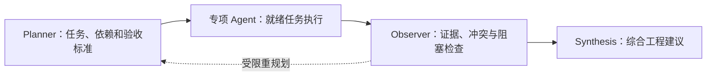

# Agent 工作流

用户消息进入 `/api/chat` 后：

1. `ChatAgent` 使用原生工具调用能力选择下一步要使用的工具。
2. 工作区工具可以列出文件、读取文件以及搜索本地代码。
3. 记忆工具用于检索当前范围内的对话历史。RAG 用于检索可复用的非结构化证据，例如 Issue 描述、PR 讨论、失败的 CI 日志、项目文档、用户上传的知识以及经过确认的记忆笔记。工作区工具和结构化工具则负责处理当前代码与实时事实。
4. 专项 Agent 分别执行 Issue、PR、CI、报告或安全分析。
5. `SafetyAgent` 处理对外写入意图并生成可审查草稿。具备审批权限的用户确认后，由草稿执行接口执行支持的 GitHub 动作；对话 Agent 本身不直接批准草稿。
6. 后端记录工具调用、引用来源、最终回答以及持久化的聊天记忆。

对于涉及多个领域的工程决策，`ChatAgent` 可以调用 `workflow.run_engineering_review`：

1. `PlannerAgent` 创建一个边界明确的 `WorkflowSpec`，其中包含任务声明、依赖关系和验收标准。
2. `WorkflowOrchestrator` 在依赖条件满足时，并行执行已经就绪的任务。
3. 现有的 Issue、PR、CI、RAG、仓库健康检查和安全能力会作为工作流任务执行。
4. `ObserverAgent` 检查任务输出中的合并门禁、跨 Agent 冲突、低置信度、证据缺失以及需要人工确认的事项。
5. `SynthesisAgent` 生成一份统一的决策备忘录，后端同时持久化 `AgentWorkflowRun` 和 `AgentTaskRun` 记录，以便后续追踪和审查。

## 执行与边界

- 依赖满足的任务按配置的并行上限执行；依赖失败会产生阻塞或跳过结果。
- 单任务设有超时，缺失或循环依赖会返回明确的错误结果。
- 观察结果可以在受限次数内触发重规划；它不表示系统可以无限自主执行。
- Skill Runtime 按任务选择指令，记录版本、激活原因和允许工具校验。
- 工具轨迹、最终引用、工作流与任务记录用于解释结果和排查问题。

代码入口：[ChatAgent](../../backend/app/services/agents/chat_agent.py)、[工作流编排](../../backend/app/services/agents/workflow_orchestrator.py)、[Skill 注册](../../backend/app/services/skills/registry.py)。

演示模式可能使用启发式回退而不调用真实 LLM。界面能展示流程，不意味着真实模型质量已经达到评测门槛。
