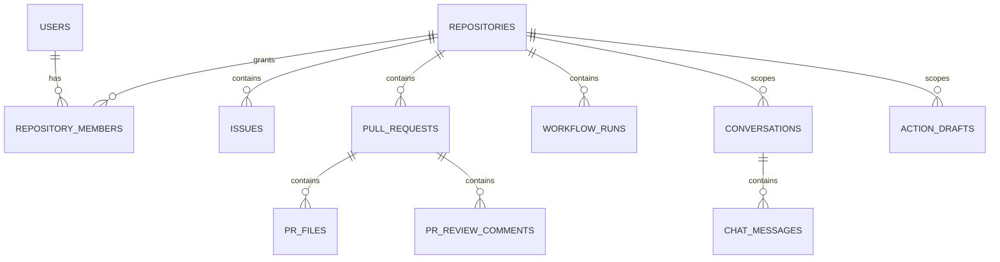

# 数据模型与存储职责

[返回 README](../../README.md) · [模型代码](../../backend/app/db/models.py)

| 领域 | 主要表 | 存储内容 |
| --- | --- | --- |
| 身份与范围 | `users`、`repository_members` | 用户角色、个人令牌摘要和仓库成员关系 |
| 仓库事实 | `repositories`、`issues`、`pull_requests`、`pr_files`、`pr_review_comments`、`workflow_runs` | 仓库配置、同步状态、PR diff、讨论与 CI jobs/logs |
| 知识与检索 | `knowledge_source_documents`、`documents`、`knowledge_base_configs`、`retrieval_test_runs` | 原始文件记录、分块文本、配置与检索测试现场 |
| 对话与记忆 | `conversations`、`chat_messages`、`chat_sessions`、`thread_memories`、`conversation_memories` | 会话、消息、封存记录和压缩记忆 |
| 工程知识 | `code_symbols`、`code_relations`、`knowledge_graph_edges` | 代码符号、关系与知识关联 |
| Agent 运行 | `agent_runs`、`agent_workflow_runs`、`agent_task_runs`、`evidence_items` | 工具轨迹、任务结果和证据 |
| 审批与反馈 | `action_drafts`、`audit_logs`、`chat_feedback` | 待审内容、执行结果、审计和反馈 |
| 任务与评测 | `background_jobs`、`eval_runs` | 租约、尝试次数、任务状态、评测现场与质量结果 |

表名与列名以模型代码为准；上表用于阅读导航。

## 核心关系

## 关系数据与向量数据分工

PostgreSQL 保存可查询的业务事实和文本元数据。`documents` 记录来源、分块正文及 metadata；文档向量由 Milvus 管理。`workflow_runs.jobs` 保存 CI job/step 信息，`eval_runs.result_json` 保存逐题现场、指标、错误与进度。

API 启动不再自动改表或删除旧字段。数据库升级通过 Alembic 执行；现有库先备份，详见 [可靠性升级](reliability_upgrade.md)。
