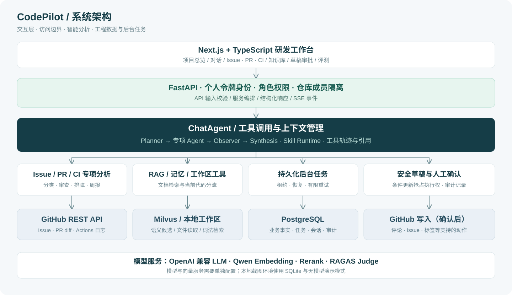
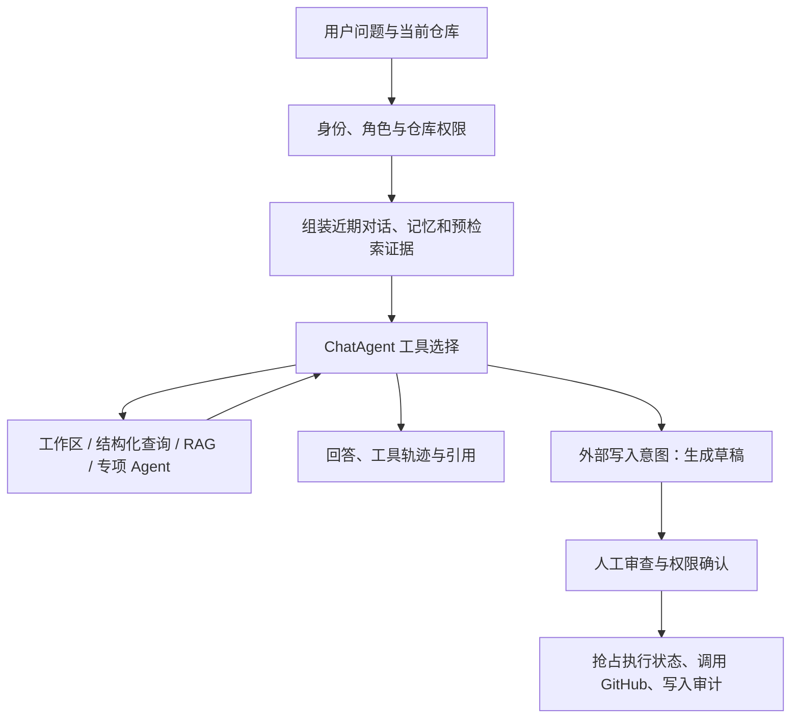

# 系统设计

[返回 README](../../README.md) · [Agent 工作流](agent_workflow.md) · [数据模型](database_schema.md)

## 服务职责

| 组件 | 职责 | 代码入口 |
| --- | --- | --- |
| Next.js 前端 | 项目总览、对话、专项分析、知识库、审批与评测 | `frontend/app` |
| FastAPI | 身份与权限、API 校验、业务编排、SSE 响应 | `backend/app/main.py`、`backend/app/api/routes` |
| ChatAgent | 根据问题与上下文选择工具，记录轨迹并生成回答 | `backend/app/services/agents/chat_agent.py` |
| WorkflowOrchestrator | 规划、按依赖执行、观察核验、综合结果 | `backend/app/services/agents/workflow_orchestrator.py` |
| PostgreSQL | 业务事实、会话、索引元数据、后台任务、审批与审计 | `backend/app/db/models.py` |
| Milvus | 存储与检索文档向量候选 | `backend/app/services/rag/vector_store.py` |
| GitHub / 模型服务 | 提供仓库事实、模型推理、Embedding 和可选重排 | `backend/app/services/github`、`backend/app/services/llm` |

Compose 中 PostgreSQL 镜像带有 pgvector 扩展，但当前文档向量检索实现使用 **Milvus**；不能据此将项目描述为“双向量数据库架构”。Redis 为可选预留服务，当前后台队列不依赖 Redis/Celery。

## 证据分流

| 信息 | 首选路径 | 原因 |
| --- | --- | --- |
| 当前源码与配置 | 当前 checkout、文件读取与词法搜索 | 代码版本应与实际分析对象一致 |
| Issue、PR、CI 的状态与团队数据 | 数据库 / GitHub API 的结构化查询 | 状态查询需要精确过滤与可核验的时效性 |
| 描述、讨论、失败日志、项目文档和批准的记忆 | RAG | 适合跨来源语义召回与引用 |
| 多轮对话历史 | 会话记忆与上下文管理工具 | 避免把所有历史原样塞入提示词 |

RAG 返回的是候选证据，不自动等于最新事实。有关当前代码与实时状态的结论需要回到对应来源核验。

## 一次对话的数据流

## 后台任务与故障处理

文档处理、项目索引、代码分析、webhook 同步和评测请求持久化到 `background_jobs`。API 进程启动轮询工作器，通过原子领取、租约续期和有限重试恢复可重建任务。这里提供的是**至少执行一次**语义，任务处理应保持幂等；外部 GitHub 写操作不进入自动重试队列。

同步成功获取远端详情后才替换本地 PR 文件或评论，失败保留旧数据并返回部分失败状态。同仓库同步在单实例内互斥，PostgreSQL advisory lock 进一步覆盖跨实例竞争；SQLite 用于单实例演示。

数据库变更通过 Alembic 显式迁移，应用启动只检查版本。多实例压力、真实模型效果和生产故障恢复仍需在目标部署环境验证，详见 [可靠性升级](reliability_upgrade.md)。
