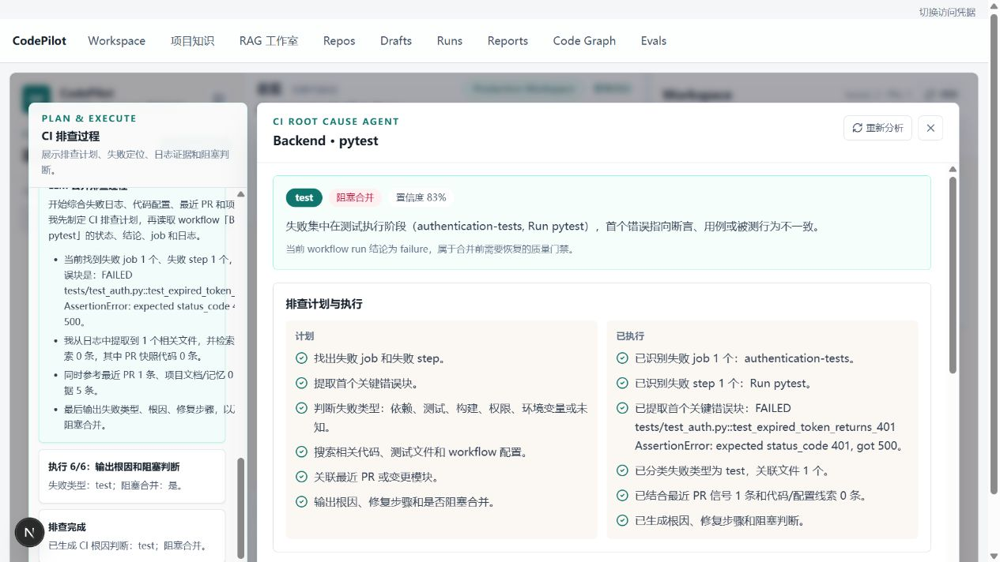

# CodePilot 项目介绍

[返回 README](../README.md) · [演示指南](demo_guide.md) · [系统设计](architecture/system_design.md)

## 项目解决什么问题

研发信息往往分散在 Issue、PR、Review 评论、CI 日志和项目文档中。回答“这个问题谁来处理”“这次改动能否合并”“CI 应该从哪里排查”，需要先找齐上下文，再判断证据是否对应当前版本。

CodePilot 将这些信息接入统一工作台，用 Agent 和检索工具辅助整理、分析和生成行动建议。它面向开发者、代码审查者与研发负责人，覆盖从“发现问题”到“形成待确认操作”的流程。

## 一个完整场景

以演示仓库中的“令牌过期返回 500”问题为例：

1. **发现问题**：Issue 列表提供问题描述、标签和负责人信息。
2. **理解变更**：PR 面板提供相关 diff、Review 评论与测试建议。
3. **定位阻塞**：CI 面板定位失败用例，展示日志中的 `expected 401, got 500`。
4. **补充证据**：知识检索查找认证规则；当前源码通过工作区工具读取。
5. **形成建议**：Agent 输出检查清单、修复方向与需验证的事项。
6. **控制写入**：评论或 Issue 等外部动作先形成草稿，由具备权限的用户确认。

图中使用合成数据与无模型分析。它展示产品流程，不代表真实项目的排障准确率。

## 仓库展示了哪些工程能力

| 能力 | 具体实现 |
| --- | --- |
| 全栈交付 | Next.js 工作台、FastAPI 服务、业务数据模型、流式对话和运行脚本 |
| Agent 工程 | 原生工具调用、任务规划、依赖执行、观察核验、结果综合和 Skill 约束 |
| 检索与知识管理 | 文档解析、切片、Embedding、混合检索、重排、上下文预算和引用 |
| 数据边界设计 | 文档证据、当前源码和实时状态使用不同检索路径 |
| 安全与可靠性 | 令牌身份、角色权限、仓库隔离、草稿防重、后台任务恢复和显式迁移 |
| 测试与评测 | 单元/回归测试、固定评测集、真实模型 Judge 接口与 CI 配置 |

## 三个值得展开讨论的设计

**为什么不把所有数据都塞进向量库？** 当前代码应以 checkout 为准，PR 是否合并应查询实时或同步状态；向量库更适合跨来源召回可复用的非结构化知识。这能减少“引用相关但版本过时”的问题。

**为什么需要人工确认？** 分析建议与外部写操作的影响不同。系统将建议保存为草稿，先审查再执行；执行前抢占状态，结果不明时保留待核对状态，避免自动重试产生重复评论。

**为什么测试通过仍需要评测？** 测试可以检查权限、状态转换和检索边界；模型是否回答正确、是否忠于证据，需要真实案例、固定数据集和 Judge 分数共同判断。两者不能互相代替。

## 已验证的结果

2026-10-31 最近一次本地验证：后端 **220 项测试通过**，前端 TypeScript 通过、Lint 零警告，生产构建成功。新增可靠性测试覆盖同步失败保留、并发防重、访问隔离、任务租约恢复、迁移与批量检索。

这些结果证明对应检查通过，不能据此推导线上业务收益、模型准确率或大规模并发能力。固定 RAGAS 基线已提供，真实分数需要配置模型并运行。

## 简历中的项目概述示例

> CodePilot — AI 研发协作平台：面向 GitHub Issue、PR 和 CI 场景的全栈 AI Agent 项目，结合多智能体工作流、RAG 知识检索与工作区工具，提供结构化分析、来源引用及人工审批草稿，并实现仓库权限隔离、后台任务恢复与回归评测。

这段描述概括仓库能力。个人职责、独立完成范围、团队规模和性能收益应按本人实际经历填写。
