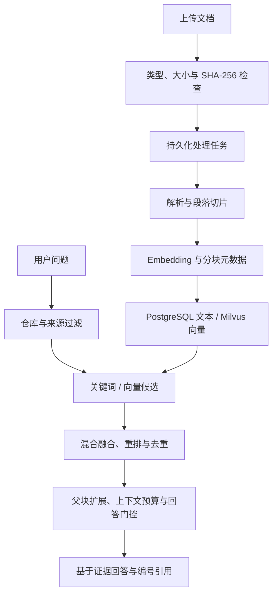

# RAG 知识检索与质量评测

[返回 README](../README.md) · [系统设计](architecture/system_design.md) · [固定案例](datas/evals/rag_cases.json)

## RAG 解决的范围

进入 RAG 的内容是需要跨来源检索、可反复复用的非结构化资料：Issue 描述、PR 说明、Review 评论、失败 CI 日志、项目文档、上传知识和批准的长期记忆。

当前源码优先走工作区文件与词法检索；Issue、PR、CI 状态等事实通过结构化查询处理。这样可以减少“语义相关但版本不对”的证据混入结论。

## 文档处理与检索链路

上传支持 TXT、Markdown、PDF、DOCX、JSON、CSV 和日志等格式；单文件最大 12 MB。重复文件按 SHA-256 识别。父块扩展按命中来源批量读取，避免每个候选重复查询相同文档。

对话链路会在进入 ChatAgent 前预检索并注入证据；Agent 也可以显式调用 `rag.search_similar_documents` 改写查询、补查资料。预检索和二次工具检索都可进入评测现场。

## 向量配置与降级状态

`EMBEDDING_PROVIDER`、`EMBEDDING_MODEL`、`EMBEDDING_DIMENSIONS` 共同定义向量空间。共享 Milvus collection 的项目应保持一致；配置不匹配时拒绝截断、补零或静默换模型。

默认可使用本地 Qwen Embedding；安装 `backend/requirements-local-embedding.txt` 后首次运行需要下载模型。远程 Embedding 和 Rerank 通过 `.env` 配置。

演示脚本使用 deterministic embedding 并关闭 Milvus，因此只能验证关键词检索、解析、关系库存储和界面引用。**`milvus · degraded` 不能被解释为完整向量检索成功。** 完整验证须检查向量服务可用、索引构建完成、模型/维度匹配，并使用真实检索案例。

已有索引改变模型或来源边界后，可执行 `POST /api/rag/{repo_id}/reindex` 重建；这属于显式数据操作，先确认目标仓库和索引范围。

## 固定评测基线

配套文件：

- [rag_cases.json](datas/evals/rag_cases.json)：10 个固定案例，包含参考答案、来源文件、必含/禁含内容或显式工具要求。
- [codepilot_baseline.md](datas/evals/codepilot_baseline.md)：案例对应的版本化参考文档。

先把参考文档上传到当前仓库知识库，待处理完成后，在 `/evals` 选择仓库和 `devflow-real-project-rag-baseline`，点击“运行固定 RAGAS 评测”。

运行时真实调用 ChatAgent，并收集预检索证据、工具调用和最终回答，再交给 RAGAS Judge。未指定固定集时的自动文档冒烟用例只适合验证链路，不能当作发布基线。

| 指标 | 评估重点 |
| --- | --- |
| Context Precision | 召回上下文是否相关 |
| Context Recall | 参考答案所需信息是否被找回 |
| Faithfulness | 回答是否忠于检索证据 |
| Answer Relevancy | 回答是否回应问题 |
| Agent Goal Accuracy | Agent 是否完成用户目标 |

系统还保留硬规则、工具调用情况、来源命中、评测集 Hash、Judge 配置和逐题错误。整体通过需要硬规则及配置的指标门槛达标；API 执行完成并不自动表示质量通过。

## 执行状态与质量状态

任务持久化后返回 `queued` 和 `eval_id`，可通过 `GET /api/evals/{eval_id}` 查看进度。状态可能是 `passed`、`failed`、`error` 或 `no_cases` 等。

- 分数偏低：质量失败，需要分析检索或回答问题。
- Judge 超时或指标缺失：评测不完整，不能当作模型质量结论。
- 可“仅重试异常评分”，复用已保存的 Agent 回答和证据。
- 回归对比需匹配评测集 Hash、Judge/RAGAS 配置和 Top-K。
- 失败用例可以生成 Issue 草稿，经人工确认后执行外部动作。

默认 Judge 复用 LLM 配置，也可以设置 `RAGAS_JUDGE_API_KEY`、`RAGAS_JUDGE_BASE_URL`、`RAGAS_JUDGE_MODEL`。

## 已验证与尚待验证

固定数据集装载、仓库隔离、检索管线、回退行为和评测结果持久化由测试覆盖。最近一次工程回归为后端 220 项测试通过；这**不是**真实模型 RAGAS 得分。仓库没有预填线上准确率或性能收益，需要在目标模型与资料集上实际运行后再报告。
